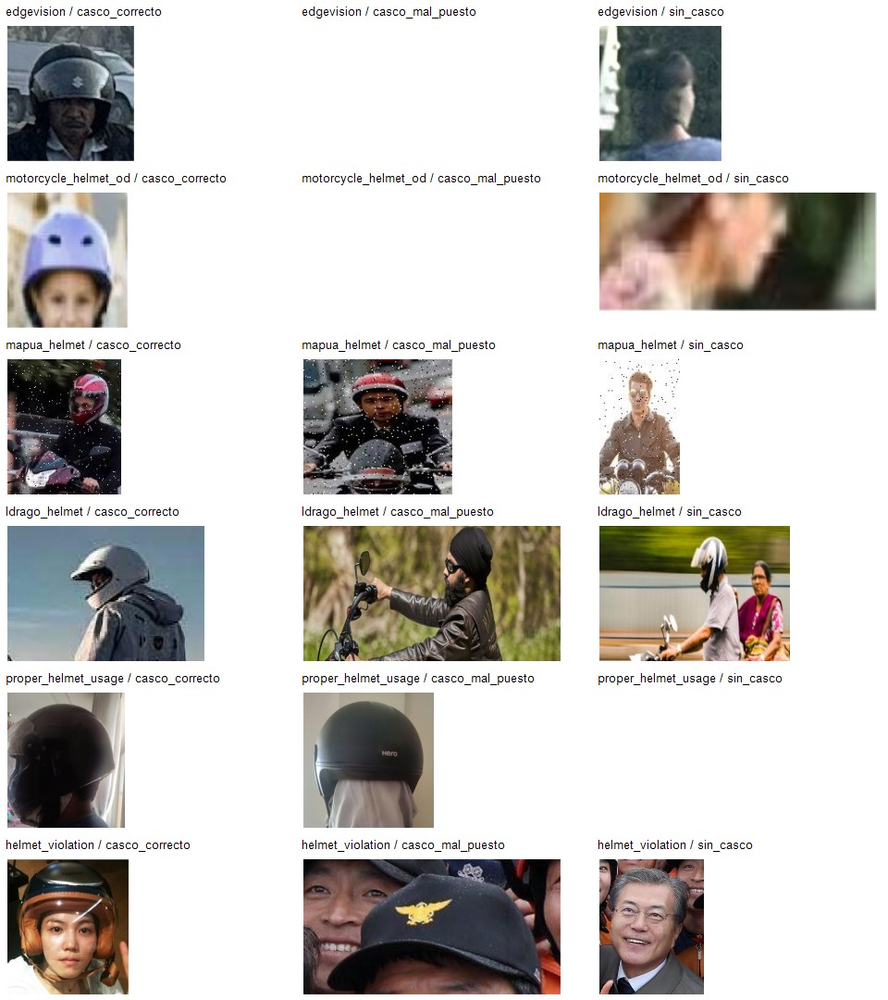

# Auditoría inicial del dataset de casco

Nota de seguimiento: este documento conserva los resultados de la primera fase. Las imágenes originales se recuperaron y validaron posteriormente; véase [Recuperación de originales](recuperacion-originales.md).

Fecha: 23 de noviembre de 2026. Fuente: [Valery-Rosero/DataSetsIA](https://github.com/Valery-Rosero/DataSetsIA).
Commit auditado: `59cce5bf75fd85e63eced06e00a5baf518062a87`.

## Dictamen

**Útil como material de partida, todavía no apto para entrenar y evaluar el sistema completo sin preparación.** Se completó la auditoría de los archivos disponibles en el repositorio: inventario, sintaxis y geometría de etiquetas, hashes exactos de recortes, dimensiones JPEG, revisión del código de preparación y una muestra visual. La auditoría de originales y videos queda pendiente porque no están incluidos.

No se entrenó ningún modelo ni se alteraron las etiquetas de la fuente.

## Conteos comprobados localmente

| Partición | Archivos de etiquetas | Etiquetas vacías | Recortes |
|---|---:|---:|---:|
| Entrenamiento | 10.242 | 923 | 22.967 |
| Validación | 1.944 | 99 | 5.110 |
| Prueba | 1.117 | 128 | 2.584 |
| Total | 13.303 | 1.150 | 30.661 |

Hay **0 imágenes originales** en `unificado/images`. Por tanto, 13.303 es el número de archivos de etiquetas comprobados, no de imágenes originales inspeccionadas. Los conteos coinciden con el resumen publicado por la fuente.

| Clase original | Cajas | Recortes |
|---|---:|---:|
| motocicleta | 3.863 | No aplica |
| casco_correcto | 19.696 | 19.328 |
| casco_mal_puesto | 1.308 | 1.296 |
| sin_casco | 10.122 | 10.037 |

Se revisaron 34.989 cajas. La clase `casco_correcto` tiene aproximadamente 15 veces más cajas que `casco_mal_puesto`. No hay una clase independiente de ocupante en la salida unificada.

## Hallazgos y decisiones

| Prioridad | Evidencia | Acción antes de entrenar |
|---|---|---|
| Alta | Los nombres de `proper_helmet_usage__VID_20260404_222258_mp4` aparecen 193 veces en train, 23 en val y 26 en test. Otro prefijo de video, `VID_20260404_153134_mp4`, aparece 12 veces en train y 4 en val. | Confirmar procedencia y reagrupar todos los fotogramas y derivados por video. Es un indicio de fuga por escena, aunque los archivos no sean idénticos. |
| Alta | El unificador conserva cajas de cabeza de unas fuentes y de persona de otras bajo las mismas clases. | No entrenar un detector único con estas cajas mezcladas. Homogeneizar las anotaciones por entidad. |
| Alta | Solo EdgeVision y Helmet Violation contienen etiquetas de motocicleta; `BikeWithRider` se convierte en motocicleta. | Revisar la diferencia moto sola/moto con conductor y completar las clases visibles o seleccionar un subconjunto exhaustivamente anotado. |
| Alta | Se descartan `person` y `rider` en el código; no se guardan asociaciones moto-ocupante-cabeza. | Recuperar etiquetas originales y anotar relaciones necesarias para contar personas. |
| Alta | `casco_mal_puesto` agrega casco en mano, gorra, pañuelo, turbante y uso incorrecto. | Redefinir las clases según cabeza visible y estado real; no convertir toda esta clase automáticamente a una sola etiqueta binaria. |
| Alta | Los originales y videos no están en Git. | Recuperar las versiones exactas antes de validar anotaciones completas o preparar el detector. |
| Media | 12 cajas exceden límites geométricos de la imagen, todas en Helmet Violation. | Revisar el original y corregir o excluir con trazabilidad. No recortar coordenadas automáticamente sin inspección. |
| Media | Una caja repetida y dos recortes idénticos asociados, dentro de train de Proper Helmet Usage. | Eliminar el duplicado de la copia preparada, conservando registro. |
| Media | 1.150 archivos de etiqueta vacíos. | Determinar con originales si son negativos válidos, etiquetas descartadas o anotaciones faltantes. No asumir que son errores ni que son negativos correctos. |
| Media | 3.723 recortes tienen al menos un lado menor de 32 píxeles (12,1 %). | Evaluar el efecto de la baja resolución y revisar los casos ilegibles. No descartarlos todos por defecto. |
| Media | El descargador elige la última versión de Roboflow y el unificador conserva splits de origen o reparte por hash del nombre. | Fijar versiones, hashes, manifiesto de grupos y particiones reproducibles. |

## Duplicados y límites de las comprobaciones

- Se calcularon hashes SHA-256 de los 30.661 recortes: un grupo duplicado, solo dentro de entrenamiento.
- No se encontraron recortes idénticos entre particiones ni idénticos con clases diferentes.
- No se encontraron nombres completos de etiquetas repetidos entre particiones.
- Esto **no descarta fuga de datos**: las recompresiones, recortes distintos, aumentos y fotogramas vecinos tienen hashes diferentes. Los prefijos de video compartidos requieren revisión.
- Todas las etiquetas pasaron las comprobaciones de número de columnas, valores finitos, identificadores de clase y coordenadas normalizadas; las 12 cajas que exceden bordes fallan una comprobación geométrica adicional.
- Se pudieron leer dimensiones en las cabeceras de todos los JPEG. Esto no equivale a decodificar completamente todas las imágenes ni prueba que no exista corrupción interna.

## Revisión visual inicial

Se inspeccionó una muestra determinista: el primer recorte de entrenamiento por nombre para cada combinación de fuente y clase existente (15 imágenes). No es una muestra estadísticamente representativa.

Observaciones de la muestra:

- Algunos recortes incluyen gran parte del cuerpo y la motocicleta; no son cabezas aisladas.
- En un recorte de LDrago etiquetado `sin_casco` aparecen un conductor con casco y una pasajera sin casco. La unidad objetivo resulta ambigua para un clasificador de imagen completa.
- Hay ejemplos de gorras y turbantes dentro de `casco_mal_puesto`, coherentes con el mapeo del código, pero incompatibles con interpretar esa etiqueta como casco mal abrochado.
- Algunos ejemplos tienen desenfoque, ruido o fondos ajenos a una escena vial. Deben evaluarse por separado de imágenes reales de cámara de tráfico.

La lista exacta de archivos está en `crop-sample.txt`.

## Revisión del código y trazabilidad

El ejemplo del README carga `yolov8n.pt`: queda excluido por el requisito de entrenar desde cero. También queda excluida su sugerencia de usar un detector preentrenado en COCO.

El unificador usa el 40 % superior de cajas de persona como aproximación de cabeza y conserva completas las cajas `Helmet-on-hand`. Esta heurística no garantiza que el recorte identifique una sola cabeza. Su ejecución elimina la carpeta de salida anterior; no se ejecutó.

El descargador considera suficiente que una carpeta Mendeley no esté vacía para omitirla y que exista `data.yaml` en Roboflow. Esas comprobaciones no garantizan una descarga completa. La preparación propia deberá validar inventario y hashes.

El README declara licencias CC BY 4.0 para las fuentes, pero **no se verificaron individualmente en esta fase**. La declaración del agregador no sustituye registrar licencia y atribución de cada versión original.

Las copias del README, los dos scripts, `data.yaml` y `resumen.txt` se conservan en `upstream-reference/` como evidencia de la revisión.

## Siguiente trabajo, en orden

1. Recuperar originales de las versiones documentadas; Roboflow requiere una credencial configurada localmente. No guardar claves en el repositorio ni compartirlas en el chat.
2. Validar correspondencia imagen-etiqueta, decodificación completa y licencias originales.
3. Crear un manifiesto por imagen, fuente, versión y escena; confirmar los grupos de video detectados y buscar duplicados visualmente similares.
4. Reanotar o seleccionar un subconjunto coherente para moto, ocupante y cabeza; revisar los archivos vacíos y errores identificados.
5. Preparar clasificación binaria revisada y particiones sin escenas compartidas, según `docs/criterios-dataset.md`.
6. Realizar la primera prueba de entrenamiento desde cero solo cuando pase esos controles.

## Reproducción

Desde la raíz: `node scripts/audit-dataset.mjs`. El archivo `dataset-audit.json` registra conteos, commit, grupos de video inferidos y rutas/líneas de todos los errores detectados. Para la muestra: `./scripts/preview-crops.ps1` en Windows.

El equipo ejecutó la auditoría con Node.js v24.15.0. El comando `python` disponible apunta a WindowsApps y falló al ejecutarse; se deberá localizar o preparar Python antes del entrenamiento. No se instaló software ni se modificó el entorno global.
