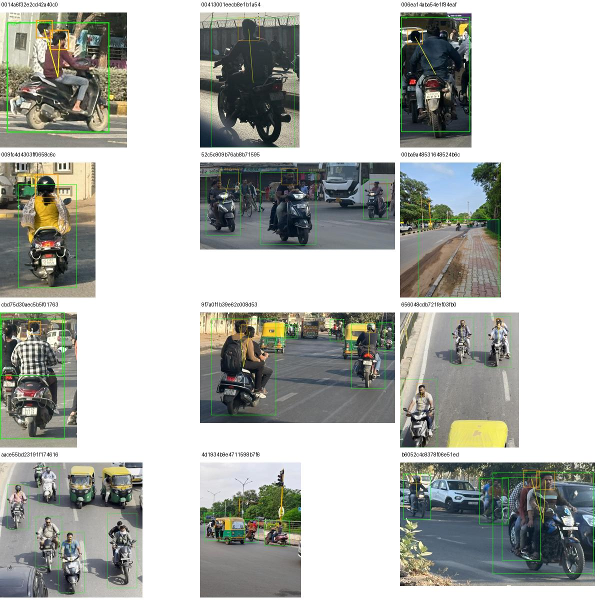
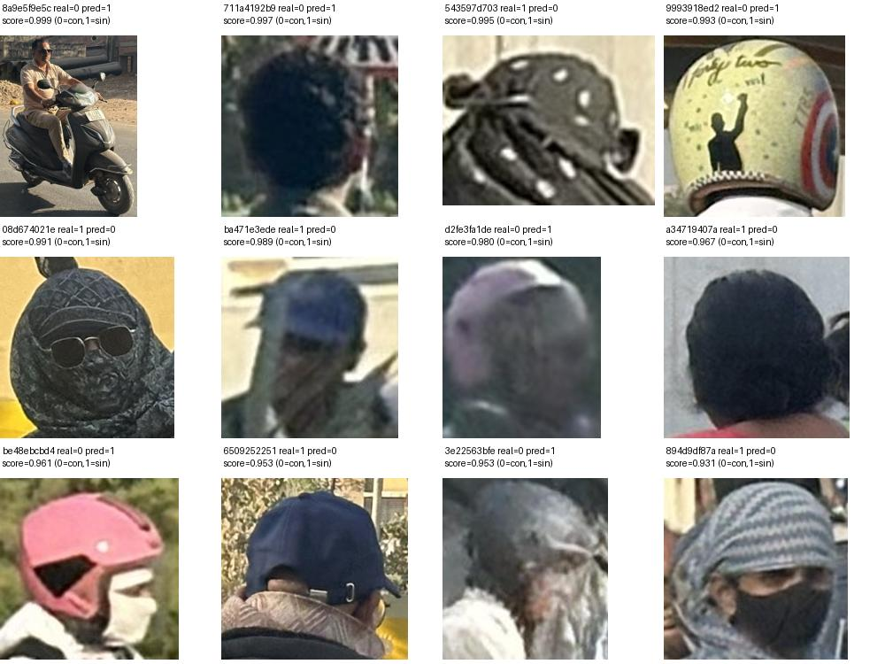

# Revisión de errores y asociación cabeza–moto

Se revisaron los checkpoints propios entrenados desde cero, sin reentrenar ni cargar pesos externos. Se usó exclusivamente validación: 347 escenas y 628 recortes. El conjunto test y las etiquetas del dataset v1 permanecen intactos.

## Hallazgos principales

1. **La localización de cabezas es el cuello de botella.** Con score mínimo 0,5 e IoU 0,5, un emparejamiento independiente de la clase del casco encuentra 356 de 623 cabezas (57,1 %); quedan 267 sin localizar. En los 356 pares, 32 tienen la clase del casco equivocada.
2. **Los objetos pequeños se detectan peor.** Exigiendo además clase correcta, se detectan 0/8 cabezas con lado menor de 24 píxeles, 13/52 entre 24 y 47 y 315/563 de 48 o más. Los tamaños corresponden a las cajas originales; el modelo reduce las imágenes antes de procesarlas.
3. **El clasificador tiene 52 desacuerdos sobre 628 etiquetas de validación.** La inspección de sus 12 desacuerdos de mayor confianza muestra fallos del modelo y etiquetas/cajas sospechosas. No todos pueden interpretarse como errores visuales reales del modelo sin revisar la anotación.
4. **Contención geométrica no prueba ocupación.** Un peatón situado detrás puede quedar dentro de la caja de la moto. También hay cajas de moto que abarcan personas de motos contiguas.

Los emparejamientos con clase obligatoria y los independientes de clase se calculan por separado; sus conteos no se suman entre sí.

## Detector a umbral 0,5

| Clase | Verdaderos positivos | Predicciones no emparejadas | Objetos no recuperados | Precisión | Recall |
|---|---:|---:|---:|---:|---:|
| Moto con ocupante | 430 | 47 | 90 | 90,1 % | 82,7 % |
| Cabeza con casco | 113 | 26 | 111 | 81,3 % | 50,4 % |
| Cabeza sin casco | 215 | 60 | 184 | 78,2 % | 53,9 % |

Estos valores usan las anotaciones existentes como referencia. Una predicción no emparejada no demuestra por sí sola que no exista el objeto: puede haber anotaciones incompletas o un fallo de localización/clase.

Se compararon también umbrales 0,3 y 0,7 (`summary.json`). Bajar a 0,3 aumenta el recall de cabezas a aproximadamente 58,9 %, pero eleva sus predicciones no emparejadas de 86 a 178. No se cambió automáticamente el umbral para favorecer una métrica ni se calibró para infracciones.

## Asociación implementada

`training/association.py` opera sobre las predicciones, sin usar etiquetas reales durante la inferencia:

- Filtra por confianza, contención de la cabeza, posición en la zona superior de la caja de moto y tamaño relativo.
- Propone la candidata de menor coste geométrico; si dos motos tienen costes cercanos, se abstiene.
- Permite varias cabezas candidatas por moto, sin imponer un único ocupante.
- Detecta solapamientos de cabeza con clases opuestas y retira las asociaciones de esas detecciones.
- Mantiene cabezas sin asignar cuando no existe una moto compatible.
- No infiere conductor/pasajero, identidad ni ocupación confirmada. Siempre devuelve `occupancy_confirmed: false` y `counting_allowed: false`.

| Estado | Cabezas en validación |
|---|---:|
| `candidate_requires_review` | 331 |
| `unassigned` | 47 |
| `conflicting_head` | 26 |
| `ambiguous` | 10 |

**331 propuestas no son 331 ocupantes correctos.** No hay etiquetas de relación cabeza–ocupante–moto en el dataset. Por eso `association_accuracy` queda en `null`; no se presenta una precisión inventada ni se utilizan los vínculos geométricos como verdad de entrenamiento.

## Inspección visual

Se generó una selección de 12 escenas: cuatro por orden fijo de identificador y ocho con más errores de detección. Se inspeccionó el mosaico, y se documentaron cuatro casos de asociación. No es una muestra representativa para estimar precisión.

- `0014a6f32e2cd42a40c0`: la propuesta cabeza 1 → moto 0 corresponde a una persona de pie al fondo; se rechaza en la revisión cualitativa. La cabeza 2 es coherente con el ocupante sentado.
- `00413001eecb8e1b1a54`: la asociación del primer plano parece consistente; no resuelve los ocupantes lejanos.
- `006ea14aba54e1f84eaf`: una caja de moto amplia incluye personas de motos contiguas; la propuesta no establece pertenencia al vehículo central.
- `009fc4d4303ff0658c6c`: dos clases opuestas sobre la misma cabeza producen abstención, evitando interpretar dos detecciones como dos personas.

Estas observaciones son revisión visual del asistente, **no anotaciones humanas validadas**. Están separadas en `visual-review.json`; no sobrescriben predicciones ni etiquetas.



Entre los errores del clasificador se marcaron tres anotaciones sospechosas: un supuesto recorte de cabeza que contiene casi toda la moto, una cabeza aparentemente sin casco etiquetada con casco y un casco aparente etiquetado sin casco. Necesitan revisión del original; no se relabelaron para mejorar retrospectivamente las métricas.



## Entregables y comprobaciones

- `detector-validation.jsonl`: predicciones, anotaciones, errores y propuestas por escena.
- `classifier-errors.json`: los 52 desacuerdos del clasificador.
- `localization-vs-classification.json`: diagnóstico independiente de clase.
- `association-review-queue.json`: 12 escenas preparadas para anotar vínculos; sin vínculos humanos inventados.
- `visual-review.json`: observaciones cualitativas separadas de la referencia.
- Seis pruebas automatizadas aprobadas: candidato no confirmado, cabeza externa, motos solapadas, múltiples cabezas por moto, clases contradictorias y ausencia de moto.
- `training/predict.py` ya devuelve `association` con estos estados. Se comprobó con el checkpoint propio y una imagen de validación; resultado en `inference-example.json`.

## Antes de contar o procesar video

El módulo de propuestas está implementado, pero **la asociación fiable todavía no está validada**. La siguiente iteración debe:

1. Revisar las etiquetas/cajas sospechosas y conservar un historial de correcciones para dataset v2, sin alterar el informe del v1.
2. Anotar cajas de ocupante y relaciones explícitas `head_id → occupant_id → motorcycle_id`, incluyendo peatones, oclusiones y relaciones no determinables.
3. Separar escenas para calibrar la asociación y para evaluarla. Medir precisión de enlaces, cobertura, abstenciones y errores sobre peatones; no solo cuántas cabezas se asignan.
4. Mejorar la detección de cabezas pequeñas mediante resolución/arquitectura y un nuevo experimento desde cero. Revisar la cadena completa antes de habilitar conteo.

Reproducción desde la raíz:

```powershell
./.venv/Scripts/python.exe training/test_association.py
./.venv/Scripts/python.exe training/review_errors.py
./.venv/Scripts/python.exe training/error_diagnostics.py
./.venv/Scripts/python.exe training/review_gallery.py
```

Los scripts regeneran los informes automáticos y la cola vacía, pero no sobrescriben `visual-review.json`. Guardar anotaciones humanas en un archivo separado antes de regenerar la cola.
