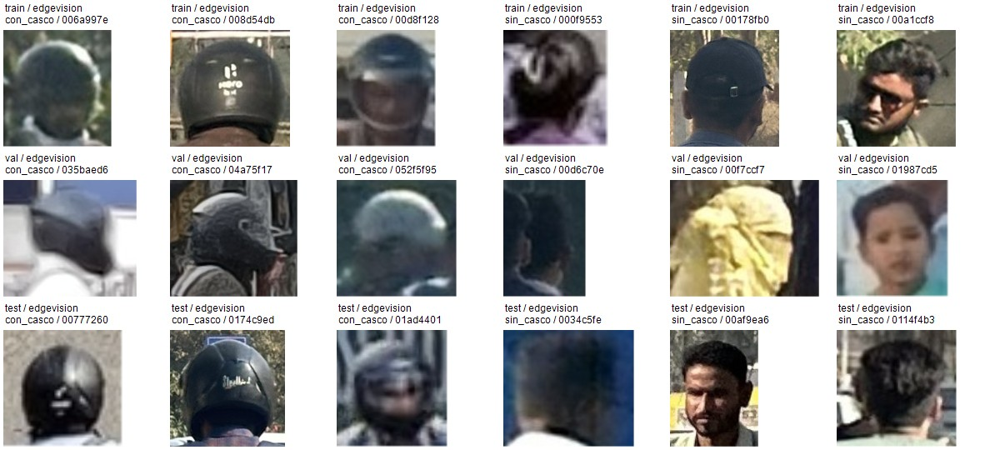
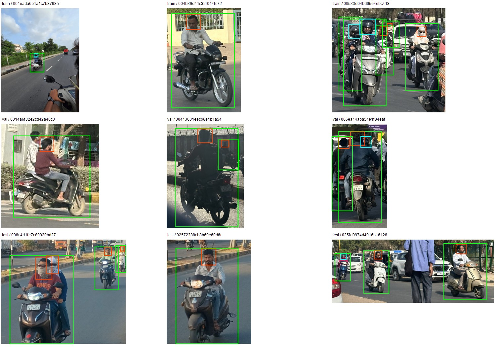

# Depuración y particiones — helmet-baseline-v1

Fecha local: 23 de noviembre de 2026. Estado: **verificado y listo para el primer entrenamiento desde cero** del detector y clasificador definidos aquí. Los originales permanecen intactos.

## Resultado final

| Partición | Imágenes del detector | Recortes con casco | Recortes sin casco | Total recortes | Grupos |
|---|---:|---:|---:|---:|---:|
| Entrenamiento | 1.583 | 1.064 | 1.825 | 2.889 | 63 |
| Validación | 347 | 226 | 402 | 628 | 15 |
| Prueba | 345 | 216 | 373 | 589 | 15 |
| **Total** | **2.275** | **1.506** | **2.600** | **4.106** | **93** |

Se utilizan 2.298 originales únicos de EdgeVision entre ambas tareas. Algunos originales aportan recortes válidos aunque estén apartados del detector. Los 93 grupos se mantienen indivisibles; el mayor contiene 62 originales utilizados. La proporción por imagen se aproxima a 70/15/15 sin romper grupos.

El detector tiene 7.753 cajas: 3.593 `moto_con_ocupante`, 1.515 `cabeza_con_casco` y 2.645 `cabeza_sin_casco`. El clasificador usa carpetas `con_casco` y `sin_casco`.

## Qué se depuró

- Se apartaron **68 imágenes de EdgeVision con cajas inválidas**: 67 afectadas por cajas fuera de los límites y una por una caja degenerada. Quitar solo las cajas habría dejado objetos sin etiquetar.
- **49 imágenes** con solapamiento sospechoso entre clases de cabeza opuestas quedaron fuera del detector. Los recortes no afectados pueden utilizarse en clasificación.
- Se descartaron **106 recortes con conflicto de etiqueta** y **121 con un lado menor de 24 píxeles**. Los motivos son conservadores, no una confirmación de que todos esos ejemplos estén mal anotados.
- Los tres originales duplicados exactos previamente detectados están marcados en el inventario. No participan en esta versión, que utiliza únicamente EdgeVision.
- **11.005 originales** no aportan ejemplos a esta versión: incluye fuentes reservadas, casos inválidos y originales sin recortes elegibles. No son 11.005 imágenes declaradas inútiles o borradas.

`image-decisions.jsonl` conserva la decisión para cada uno de los 13.303 originales; `annotation-decisions.jsonl` registra cada exclusión de recorte. Los motivos por imagen pueden coincidir y no se deben sumar como categorías excluyentes.

## Por qué se reservó Motorcycle Helmet OD

La revisión visual de la primera selección reveló mosaicos de varias fotografías y recortes de fondo, cabezas parciales o regiones cuya clase no es identificable. Tres ejemplos inspeccionados en sus originales fueron:

- `BikesHelmets353_png_jpg.rf.3fd0f755728bf3aac20f483b47433038.jpg`, anotación 5.
- `BikesHelmets689_png_jpg.rf.e843793c555fa24d353fc80391a01bf6.jpg`, anotación 0.
- `BikesHelmets565_png_jpg.rf.83a16eb96d62b7e6cf24e8fa11dd4a37.jpg`, anotación 0.

Una misma pieza puede aparecer transformada en distintos mosaicos. El hash exacto o el dHash global no garantizan agrupar esas piezas. Por tanto, **sus 3.607 imágenes no se usan en ninguna partición de esta versión**. Antes de incorporarlas hay que recuperar versiones sin mosaicos o identificar la procedencia de las piezas y revisar las cajas.

Se conservó `rejected-multisource-sample.jpg` y su selección JSON como evidencia. El borrador de 18.117 recortes fue descartado; no es el conjunto final.

Mapua, LDrago, Proper Helmet Usage y Helmet Violation permanecen reservados por diferencias de geometría, significado de clases o necesidad de reanotación. Esto evita mezclar cabeza, persona y moto bajo una misma etiqueta.

## Protección de las particiones

Se agruparon hashes exactos, derivados de exportación, identificadores de video disponibles y candidatos de similitud. Los candidatos se mantienen juntos por precaución; no se declararon duplicados ni se borraron por esa razón. Para EdgeVision se añadieron bloques de 25 nombres consecutivos, conectados con las demás relaciones.

Los recortes y el detector comparten el split de su original. Una imagen no puede contribuir al entrenamiento del clasificador y a la prueba del detector.

**Límite:** los bloques de nombres y la similitud son heurísticas; no sustituyen metadatos reales de escena. Se eliminaron los cruces conocidos, pero no se certifica independencia completa por escena o cámara. La evaluación final de la aplicación requerirá datos externos reservados.

## Verificaciones ejecutadas

- Tres pruebas automatizadas: rechazo de geometría inválida, agrupación transitiva y asignación reproducible independiente del orden de entrada.
- Correspondencia entre cada anotación exportada y el original; comprobación de clases, coordenadas, dimensiones, identificadores y conteos de archivos.
- Hashes de los originales utilizados y de las copias del detector; hashes y dimensiones JPEG de todos los recortes.
- **0 grupos de recortes idénticos, 0 duplicados exactos entre splits y 0 relaciones conocidas que crucen particiones.**
- Verificación de que solo EdgeVision participa en el conjunto aprobado.
- Revisión visual de 9 imágenes del detector y 18 recortes, estratificada por partición y clase. Es control de muestra, no revisión exhaustiva de todas las anotaciones.

Resultados completos: `verification.json`. Huellas de fuentes, scripts y manifiestos: `dataset-lock.json`.

## Uso y límites del modelo

El dataset está en `data/prepared/helmet-baseline-v1/`. La guía `docs/dataset-preparado.md` describe su estructura, reproducción y contrato de entrenamiento.

- Está listo para entrenar un **detector de moto con ocupante y estado visible del casco**, y un **clasificador de cabeza con/sin casco**, con inicialización aleatoria.
- Aún **no proporciona cajas independientes de cada ocupante**, por lo que no resuelve por sí solo el conteo separado de conductor y pasajeros.
- No permite certificar casco bien abrochado o uso correcto. Esas categorías requieren anotaciones adicionales.
- No se cargó ningún modelo preentrenado ni se inició entrenamiento.

El próximo paso es preparar el entorno y entrenadores desde cero para este baseline; en paralelo al desarrollo futuro, la ampliación a ocupantes separados requerirá una fase explícita de anotación.
