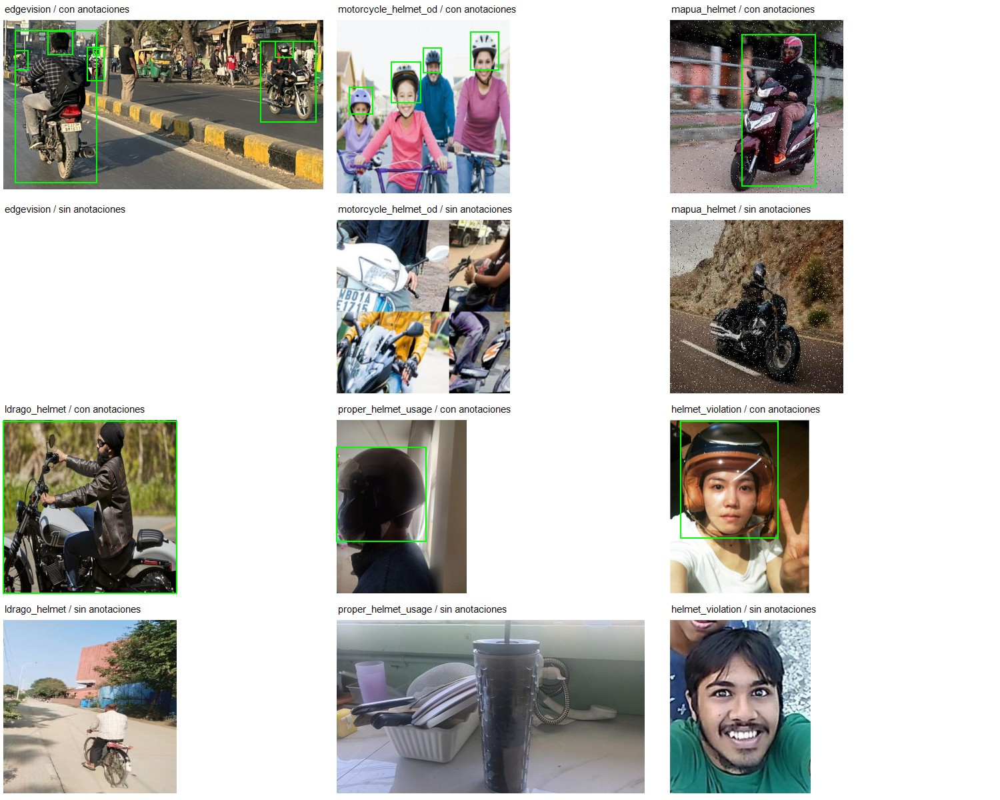

# Recuperación y validación de imágenes originales

Fecha local: 23 de noviembre de 2026 (America/Bogota). Los recibos automáticos usan UTC.

## Resultado

**Se recuperaron las 13.303 imágenes originales de las seis fuentes y se validó su lectura.** Las versiones coinciden con las utilizadas en el repositorio agregado. Los 13.303 archivos de etiquetas unificadas coinciden con la transformación de sus originales, dentro de una tolerancia de 0,000002 en coordenadas normalizadas.

Esto confirma procedencia y correspondencia; no significa que las anotaciones sean completas o apropiadas para nuestro modelo. Se mantienen los problemas semánticos y de particiones detectados en la auditoría inicial. No se ha entrenado ningún modelo, eliminado ejemplos originales ni cambiado particiones.

## Inventario comprobado

| Fuente | Versión | Imágenes | Decodificadas | Etiquetas unificadas coincidentes | Archivos originales vacíos |
|---|---:|---:|---:|---:|---:|
| EdgeVision | 1 | 2.392 | 2.392 | 2.392 | 0 |
| Motorcycle Helmet OD | 1 | 3.607 | 3.607 | 3.607 | 1 |
| Mapua | 8 | 3.749 | 3.749 | 3.749 | 397 |
| LDrago | 10 | 2.258 | 2.258 | 2.258 | 681 |
| Proper Helmet Usage | 6 | 950 | 950 | 950 | 65 |
| Helmet Violation | 1 | 347 | 347 | 347 | 5 |
| **Total** | | **13.303** | **13.303** | **13.303** | **1.149** |

La salida unificada tiene 1.150 archivos vacíos: la diferencia de uno se debe a la transformación y descarte de clases. Los archivos vacíos originales no se marcaron automáticamente como errores ni como negativos válidos.

Las descargas tienen versiones fijas y SHA-256 registrados en `data/sources.lock.json` y `reports/*-download.json`. Los hashes identifican la copia local; no se contrastaron con checksums publicados por los proveedores.

## Calidad de las anotaciones

- **EdgeVision:** 8.275 cajas originales; 78 se salen de los límites y una no tiene área válida, repartidas en 68 imágenes. El agregador recorta las cajas al borde y descarta la caja degenerada, de modo que conserva 8.274 cajas. Se reprodujo esa transformación para verificar correspondencia; no se modificaron los originales.
- **Roboflow:** las 10.911 imágenes tienen archivo de etiquetas y coinciden con el agregador. Se conservan las anotaciones `person` y `rider` originales que el agregador había descartado. Las 12 cajas fuera de límites de Helmet Violation ya estaban identificadas en la primera auditoría.
- **Semántica:** siguen mezclándose cajas de cabeza, persona y moto con conductor. Una coincidencia numérica con el agregador no resuelve esta diferencia.

## Duplicados y particiones

### Confirmados por SHA-256

Se encontraron **tres pares de imágenes idénticas**, todos en Helmet Violation:

| Prefijo de imagen | Particiones |
|---|---|
| `55_jpeg` | entrenamiento y validación |
| `6_jpg` | entrenamiento y prueba |
| `gettyimages-1224204239-612x612_jpg` | entrenamiento y prueba |

El informe JSON conserva las rutas completas. Estos duplicados no se detectaban comparando solo los recortes del clasificador. Antes de evaluar, cada original y sus derivados deben quedar en un único grupo/partición.

### Candidatos por similitud visual

Se compararon las 13.303 imágenes con dHash de 64 bits y distancia Hamming máxima de 4:

- 2.654 pares candidatos, agrupados en 459 componentes que incluyen 1.714 imágenes.
- 640 pares candidatos cruzan particiones; pertenecen a 126 componentes.
- 9 pares candidatos cruzan fuentes.

**No son 2.654 duplicados confirmados.** Fondos similares, imágenes poco detalladas y cadenas de similitud pueden producir falsos positivos. Los grupos sirven para revisión y no se usaron para borrar imágenes o asignar splits automáticamente. Tampoco este método garantiza descubrir todos los duplicados.

Se mantienen los dos grupos de video inferidos por nombre en Proper Helmet Usage que cruzan particiones. Las escenas desconocidas siguen marcadas como `scene_unknown`, sin inventar identificadores independientes por imagen.

## Revisión visual de originales

Se inspeccionaron 11 imágenes: el primer original con anotaciones y el primer original sin ellas por fuente, cuando existe. Es una muestra exploratoria, no una estimación estadística de calidad.

Observaciones:

- Mapua contiene al menos un ejemplo sin etiquetas en el que se ve una motocicleta y una persona con casco: los archivos vacíos requieren revisión, no pueden aceptarse todos como fondo.
- Motorcycle Helmet OD incluye una imagen de ciclistas con casco. Es útil para estudiar apariencia de casco, pero no demuestra detección de motociclistas.
- Algunos negativos muestran objetos o personas fuera del contexto vial. Debemos separar ejemplos útiles de clasificación de los aptos para evaluar tráfico.
- Las cajas de LDrago y Mapua abarcan regiones mucho mayores que una cabeza; EdgeVision tiene una categoría explícita de moto con conductor. No se pueden equiparar sin revisar.

La selección exacta se conserva en `originals-sample.txt`. Las cajas de polígonos se muestran mediante su envolvente rectangular para facilitar la inspección.

## Licencias y credenciales

EdgeVision declara CC BY 4.0 en su [página oficial](https://data.mendeley.com/datasets/j82bnw7gsr/1), verificada el 23/11/2026. Las cinco fuentes Roboflow declaran CC BY 4.0 en la API y sus exports conservan los README de atribución. Véase `docs/recuperar-originales.md` para autores y enlaces. No se ha auditado la procedencia individual de cada fotografía.

La clave de Roboflow se leyó desde `.env`, excluido de Git. Los informes y manifiestos no incluyen la clave ni las URLs privadas de exportación.

## Archivos producidos

- `data/sources/originals/`: originales y anotaciones extraídos, excluidos de Git.
- `data/sources.lock.json`: proveedores, versiones, licencias y hashes de archivos ZIP.
- `reports/edgevision-manifest.jsonl` y `reports/roboflow-manifest.jsonl`: inventario por imagen y anotaciones originales.
- `reports/edgevision-originals-audit.json` y `reports/roboflow-originals-audit.json`: correspondencia, conteos e incidencias.
- `reports/roboflow-image-decoding.jsonl`: lectura completa, dimensiones y dHash; EdgeVision incluye estos campos en su manifiesto.
- `reports/original-similarity-candidates.json`: duplicados exactos y candidatos visuales.
- `scripts/`: herramientas reproducibles de descarga, extracción, auditoría y muestras.

## Próximo paso

Preparar un conjunto revisado: resolver duplicados y agrupación por escena, revisar negativos y cajas inválidas, y seleccionar/reanotar un subconjunto consistente de moto, ocupante y cabeza. Después generar particiones definitivas por grupos y comenzar el primer entrenamiento desde cero.

Los 32 videos de Zacatecas todavía no se descargaron: se reservan para la fase de video y conteo, una vez definido el escenario de cámara. Esta etapa se centró en recuperar y validar todas las imágenes del dataset agregado.
