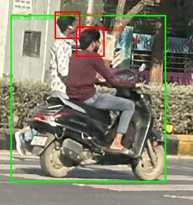

# Primer entrenamiento desde cero

Se completaron dos entrenamientos locales con inicialización aleatoria, sin cargar pesos preentrenados. GPU: NVIDIA GeForce RTX 3060. Entorno: Python 3.14, PyTorch 2.11.0+cu128 y torchvision 0.26.0+cu128.

## Resultados de validación

| Modelo | Entrenamiento | Validación | Épocas | Mejor época | Métrica |
|---|---:|---:|---:|---:|---|
| Clasificador CNN propio | 2889 recortes | 628 recortes | 15 | 11 | Macro-F1: 0.9100; accuracy: 0.9172 |
| Faster R-CNN con backbone propio aleatorio | 1583 imágenes | 347 imágenes | 5 | 5 | mAP@0.50: 0.6912 |

Estas métricas son de validación interna y se utilizaron para seleccionar el checkpoint. El conjunto test no se utilizó. No son una medición independiente en tráfico real ni una garantía de seguridad.

### Clasificador

| Clase | Precisión | Recall | F1 |
|---|---:|---:|---:|
| Con casco | 0.8884 | 0.8805 | 0.8844 |
| Sin casco | 0.9332 | 0.9378 | 0.9355 |

Matriz de confusión: filas reales, columnas predichas; orden con casco / sin casco.

```text
[199, 27]
[25, 377]
```

### Detector

| Clase | AP@0.50 | Cajas reales en validación |
|---|---:|---:|
| Moto con ocupante | 0.8599 | 520 |
| Cabeza con casco | 0.6041 | 224 |
| Cabeza sin casco | 0.6097 | 399 |

AP interpolada en 101 puntos con IoU 0,50 y hasta 100 detecciones por imagen. No equivale a COCO mAP@0.50:0.95. Es un primer experimento corto, con red pequeña y resolución de 384–640 píxeles; las cabezas lejanas pueden resultar difíciles.

## Evidencia y artefactos

- `runs/classifier-baseline/best.pt` y `runs/detector-baseline/best.pt`: checkpoints propios, seleccionados por validación.
- `last.pt`: última época de cada ejecución.
- Configuración, curvas por época y resultados resumidos copiados en las carpetas `classifier/` y `detector/` de este informe.
- Configuraciones con `pretrained: false`, semilla, huella de estado inicial y huellas de código/dataset.
- Los estados finales tienen huellas diferentes de los iniciales. Ambas ejecuciones iniciaron sus redes de nuevo; no continuaron los checkpoints de las pruebas pequeñas.
- Clasificador: 294,258 parámetros. Detector: 7,944,911 parámetros.
- Duración de bucles de entrenamiento/validación: 51.7 s y 252.2 s respectivamente; no incluye instalación ni preparación inicial.

Las bibliotecas de redes neuronales son herramientas de implementación, no modelos preentrenados. Se utilizó la arquitectura Faster R-CNN, pero su backbone, propuestas y cabezas se inicializaron aleatoriamente.

## Alcance y próximos pasos

El clasificador recibe un recorte de cabeza; no localiza por sí mismo al motociclista. El detector tiene la clase moto con ocupante, no cajas independientes de cada pasajero. No se evalúa casco abrochado correctamente.

Antes de integrar cámara y conteo: revisar errores en validación, decidir arquitectura/resolución y duración del siguiente experimento, y medir la cadena detector-clasificador. El conjunto de prueba debe permanecer reservado hasta fijar el experimento. Todavía falta una evaluación con cámara/video externos.

Véase `training/README.md` para repetir el entrenamiento y ejecutar inferencias con pesos propios.

## Comprobación de inferencia

Se recargaron ambos checkpoints propios con `weights_only=True` y se ejecutó una predicción con cada uno. El ejemplo del detector utiliza la primera imagen de validación por nombre, con umbral 0,5, sin seleccionar una imagen según su resultado. Detecta la moto y también una cabeza al fondo: antes de contar infracciones es necesario asociar las cabezas con los ocupantes de la moto. Esta imagen no demuestra que la cadena completa esté resuelta.


