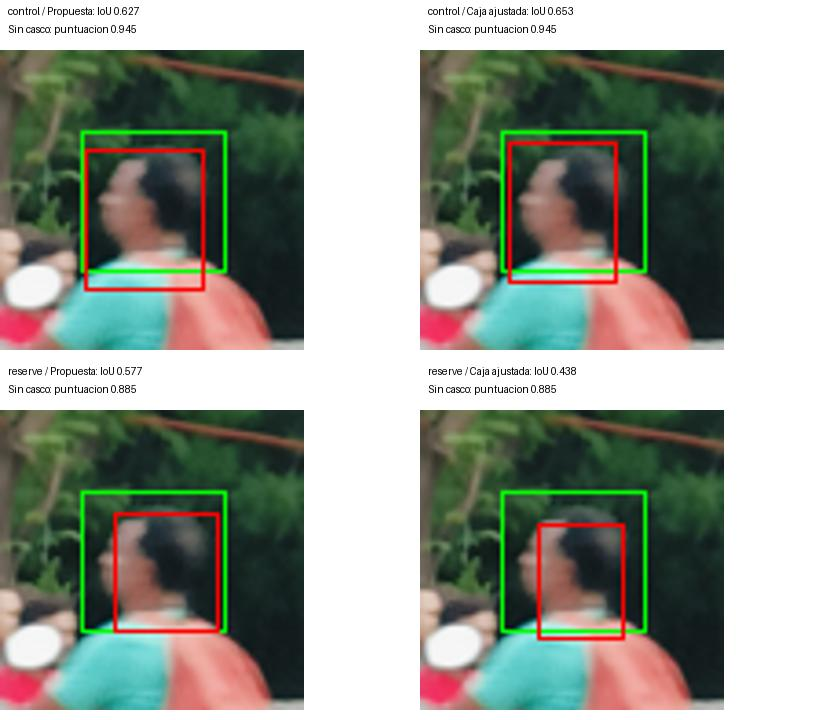

# Comparación de propuestas y clasificación: reserva frente a controles

Se evaluaron los ocho checkpoints last.pt del paso 1950 con la misma validación, agrupación y batch 2. No hubo entrenamiento, cambios de etiquetas, pesos ni umbrales. Se reprodujo el mAP almacenado de los ocho modelos y se verificó que el estado completo del modelo y el archivo de pesos permanecieron intactos.

## Qué cambió y qué no

La reserva garantiza que cada objeto elegible reciba al menos un positivo durante el muestreo RPN. No garantiza que la red asigne buen objectness a cabezas nuevas ni que el clasificador o el ajuste de cajas generalicen. Los ocho modelos siguen teniendo propuestas decodificadas que cubren las seis cabezas sin casco; la mayor pérdida ocurre al seleccionar las 2000 mejor puntuadas.

| Train | Semilla | Cabezas con propuesta final: control → reserva | AP sin casco: control → reserva |
|---|---|---|---|
| 35 | 20261124 | 2/6 → 2/6 | 8.42 % → 16.83 % |
| 44 | 20261124 | 1/6 → 1/6 | 16.83 % → 0.00 % |
| 35 | 20261125 | 0/6 → 1/6 | 0.00 % → 0.00 % |
| 44 | 20261125 | 1/6 → 1/6 | 0.00 % → 8.42 % |

NMS y el límite posterior no reducen más la cobertura de las cabezas sin casco en estos casos. Esta cobertura se calcula por referencia, no es recall uno a uno. Los objetos de las seis referencias se repiten entre modelos; no son 48 ejemplos independientes.

## Diagnóstico por pareja

### 35 imágenes, semilla 20261124

Se conservan las mismas dos cabezas cubiertas por propuestas: Image_01474 h0 e Image_01087 h0. En ambas, la clase de probabilidad máxima de las propuestas cubrientes sigue siendo fondo. La puntuación sin casco máxima sobre propuestas cubrientes de Image_01474 sube de 0,048 a 0,140; el AP mejora, pero no aparecen más cabezas detectadas ni aciertos a confianza 0,5. Que fondo sea argmax no impide emitir otra clase por encima del umbral interno.

### 44 imágenes, semilla 20261124

Image_01474 h0 conserva propuestas válidas. Su mejor propuesta cubriente por puntuación sin casco tiene probabilidad 0,885 e IoU inicial 0,577, pero el regresor de cajas la lleva a IoU 0,438. Antes de NMS no queda ninguna caja ajustada sin casco con IoU ≥0,5 y puntuación >0,05 sobre esa referencia. Las cajas ajustadas con mejor IoU tienen puntuaciones insuficientes. Por tanto, la pérdida del acierto no se explica aquí por NMS ni por no proponer la cabeza: interviene el ajuste de coordenadas y su desacople respecto de la puntuación.

Verde: anotación humana; rojo: propuesta de mayor puntuación sin casco que inicialmente cubre la cabeza, antes y después de su regresión. El gráfico amplía el recorte para inspección, no representa su resolución efectiva. En el control, esa propuesta pasa de IoU 0,627 a 0,653; con reserva pasa de 0,577 a 0,438. Esta comparación no modifica el detector ni las etiquetas.

### 35 imágenes, semilla 20261125

La reserva recupera propuestas para Image_01087 h0: el mejor rango cubriente mejora de 2342 (fuera del top 2000) a 1274. Sin embargo, las dos propuestas cubrientes eligen fondo como clase máxima. La de mayor puntuación sin casco tiene 0,078 y empeora de IoU 0,520 a 0,461 al ajustar la caja. No hay candidato ajustado que cumpla simultáneamente IoU ≥0,5 y puntuación >0,05. El AP sigue en cero.

### 44 imágenes, semilla 20261125

La cabeza con propuesta cambia: se pierde Image_01087 h0 y se recupera Image_02284 h0. En esta última el rango mejora de 4187 a 1537; su propuesta se clasifica sin casco con puntuación 0,714 y pasa de IoU 0,638 a 0,594 tras la regresión. Produce un acierto a confianza 0,5, pero el modelo también produce dos falsos positivos. Recupera un caso; no mejora uniformemente las seis referencias.

## Ranking detallado de sin casco

Rango de la mejor propuesta decodificada con IoU ≥0,5, ordenada por objectness. Valores >2000 quedan fuera del corte.

| Train / semilla | Imagen / cabeza | Control | Reserva |
|---|---|---:|---:|
| 35 / 20261124 | Image_01474 / h0 | 727 | 646 |
| 35 / 20261124 | Image_01087 / h0 | 1235 | 412 |
| 35 / 20261124 | Image_01087 / h3 | 9689 | 11755 |
| 35 / 20261124 | Image_02284 / h0 | 4284 | 6434 |
| 35 / 20261124 | Image_01756 / h0 | 2558 | 3020 |
| 35 / 20261124 | Image_01756 / h1 | 3506 | 4448 |
| 44 / 20261124 | Image_01474 / h0 | 653 | 1321 |
| 44 / 20261124 | Image_01087 / h0 | 2148 | 4384 |
| 44 / 20261124 | Image_01087 / h3 | 5283 | 11454 |
| 44 / 20261124 | Image_02284 / h0 | 3105 | 3243 |
| 44 / 20261124 | Image_01756 / h0 | 3213 | 3998 |
| 44 / 20261124 | Image_01756 / h1 | 3213 | 3833 |
| 35 / 20261125 | Image_01474 / h0 | 3102 | 2798 |
| 35 / 20261125 | Image_01087 / h0 | 2342 | 1274 |
| 35 / 20261125 | Image_01087 / h3 | 23168 | 6436 |
| 35 / 20261125 | Image_02284 / h0 | 4247 | 7077 |
| 35 / 20261125 | Image_01756 / h0 | 3366 | 3065 |
| 35 / 20261125 | Image_01756 / h1 | 4176 | 4369 |
| 44 / 20261125 | Image_01474 / h0 | 3947 | 10261 |
| 44 / 20261125 | Image_01087 / h0 | 1594 | 2953 |
| 44 / 20261125 | Image_01087 / h3 | 12477 | 6193 |
| 44 / 20261125 | Image_02284 / h0 | 4187 | 1537 |
| 44 / 20261125 | Image_01756 / h0 | 4022 | 3776 |
| 44 / 20261125 | Image_01756 / h1 | 6928 | 6608 |

## La reserva no es un balanceo de clases

Los registros reales muestran una redistribución pequeña del volumen total de positivos sin casco. Comparación dentro de cada ejecución con reserva: sorteo habitual antes de reparar → selección reparada. No son los registros de los controles históricos.

| Train | Semilla | Fracción de positivos RPN sin casco antes → después | Aumento de positivos sin casco |
|---|---|---|---:|
| 35 | 20261124 | 4.23 % → 4.32 % | 2.15 % |
| 44 | 20261124 | 3.93 % → 4.00 % | 1.90 % |
| 35 | 20261125 | 4.24 % → 4.32 % | 1.90 % |
| 44 | 20261125 | 3.93 % → 4.00 % | 1.91 % |

Evitar 1077 omisiones en presentaciones repetidas de cabezas no equivale a aumentar mucho su peso total frente a motos y personas. La reserva operó sobre todas las clases y conservó los presupuestos. Esta observación describe su alcance; no demuestra que un balanceo más fuerte vaya a mejorar la validación.

## Clasificación con las cajas reales

También se midieron probabilidades sobre las cajas humanas, sin usarlas en la inferencia normal. Por ejemplo, Image_01474 h0 con 44 imágenes/semilla 24 pasa de aproximadamente 0,74 a 0,27 de probabilidad sin casco sobre la misma caja real. Esto indica un cambio de respuesta de las características/clasificador sobre una región fija, además de la variación de propuestas. No aísla causalmente el backbone del clasificador, ni constituye una métrica de detección. Los vectores completos están en los JSON.

## Decisión y siguiente paso

La reserva resuelve una propiedad del muestreo, pero los fallos de validación siguen repartidos entre ranking RPN, rechazo como fondo y ajuste de cajas. No hay base para adoptarla como configuración predeterminada ni para habilitar conteo. No puede concluirse que el cambio sea siempre perjudicial o que una sola causa explique toda la trayectoria de entrenamiento.

Antes de otro entrenamiento, conviene una prueba diagnóstica congelada que compare, para las mismas puntuaciones de cabeza, las cajas propuestas frente a las cajas ajustadas, midiendo detección y falsos positivos de ambos controles y variantes. Debe declararse como intervención diagnóstica, no ajuste del sistema de producción ni selección retrospectiva de una semilla. Así se puede cuantificar cuánto cuesta la regresión frente al ranking y clasificación sin cambiar a la vez varias piezas del entrenamiento.

No aumentar directamente la cuota de reserva o top-k basándose solo en estos resultados: hay casos donde llegar al clasificador no produce un acierto. Si después se decide entrenar otro cambio, mantener parejas y pasos fijos y registrar los mismos componentes.

## Verificación y límites

- Misma validación de cinco imágenes: seis cabezas sin casco y tres con casco, consultadas repetidamente. Dos semillas no prueban generalización.
- Reutilización de la descomposición RPN contrastada contra filter_proposals; antes/después de top-k, filtro de tamaño, NMS y límite final.
- Probabilidades de propuestas reales y cajas humanas separadas; cajas ajustadas por clase inspeccionadas antes del umbral final y NMS.
- Métricas de los ocho checkpoints reproducidas con tolerancia 1e-6; fingerprints de pesos y buffers y hashes de checkpoints sin cambios.
- Ningún conjunto test usado, ningún peso externo cargado, ningún gradiente calculado ni entrenamiento ejecutado.
- La primera carpeta proposal-comparison conserva el diagnóstico inicial. Esta versión añade la caja concreta antes/después para identificar la pérdida por regresión.

Reproducción: `.venv/Scripts/python.exe training/compare_reserved_proposals.py --output <carpeta-nueva>`. La salida debe ser nueva. Los JSON guardan las nueve cabezas por modelo, probabilidades y coordenadas en la escala interna del detector.
