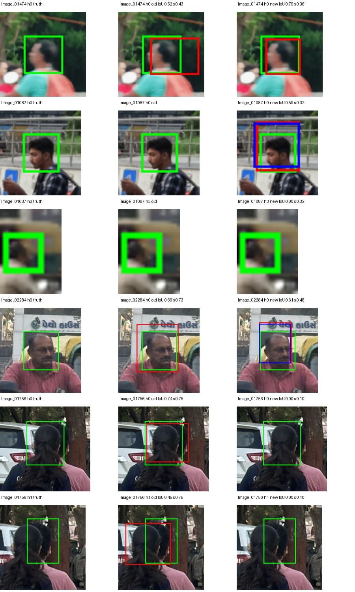

# Revisión de fallos sin casco

Comparación congelada: checkpoint anterior de época 136 (25 imágenes train) y nuevo de época 108 (35 imágenes train). Ambos se entrenaron desde cero. Esta revisión solo ejecuta inferencia: no modifica pesos, etiquetas, umbrales ni test. Se verificaron hashes del dataset y checkpoints, validación idéntica y reproducción del mAP guardado con batch 2 y la misma agrupación de imágenes.

## Qué explica la caída

El AP sin casco baja de 50,50 % a 37,87 %. A umbral interno 0,05, ambos modelos aciertan 3 de las 6 referencias mediante correspondencia uno a uno; cambian cuáles detectan y el orden de confianza. Los falsos positivos pasan de 2 a 7.

En el anterior, los tres primeros resultados sin casco son aciertos. En el nuevo, el primer resultado es un casco real etiquetado como sin casco (Image_00734, puntuación 0,575, IoU 0,597); después vienen tres aciertos. La precisión máxima hasta esos aciertos es 3/4 en vez de 3/3. Con el mismo recall máximo de 3/6, esto explica exactamente el cambio de AP interpolado de 50,50 % a 37,87 %. Los seis falsos positivos posteriores no explican una caída adicional de este AP interpolado, aunque siguen siendo errores.

| Confianza mínima | Anterior TP / FP / FN | Nuevo TP / FP / FN |
|---|---:|---:|
| 0,05 | 3 / 2 / 3 | 3 / 7 / 3 |
| 0,50 | 2 / 0 / 4 | 0 / 1 / 6 |

No basta bajar el umbral: el falso positivo principal tiene más puntuación que cualquiera de los aciertos. No se ha elegido un umbral nuevo.

## Las seis cabezas

IoU y puntuación de la predicción sin casco de mayor IoU, incluso cuando no es un acierto. Un guion indica que no se emitió ninguna predicción de esa clase en la imagen.

| Imagen / cabeza | Antes IoU / puntuación | Ahora IoU / puntuación |
|---|---:|---:|
| Image_01474 / h0 | 0.519 / 0.425 | 0.794 / 0.361 |
| Image_01087 / h0 | — | 0.591 / 0.317 |
| Image_01087 / h3 | — | 0.000 / 0.317 |
| Image_02284 / h0 | 0.686 / 0.734 | 0.607 / 0.482 |
| Image_01756 / h0 | 0.735 / 0.745 | 0.000 / 0.100 |
| Image_01756 / h1 | 0.448 / 0.745 | 0.000 / 0.100 |

- Image_01474 h0: mejora la caja (IoU 0,519→0,794), pero baja la puntuación. Vista lateral con desenfoque visible.
- Image_01087 h0: nuevo acierto recuperado. También aparece una caja con casco (IoU 0,536, puntuación 0,303) muy próxima a sin casco (0,317). Es una contradicción explícita entre clases.
- Image_01087 h3: cabeza pequeña, borrosa y parcialmente oculta; ambos la omiten.
- Image_02284 h0: mantiene el acierto, pero baja de 0,734 a 0,482 y cruza el umbral operativo de 0,5. También aparece casco con puntuación 0,064.
- Image_01756 h0: pierde un acierto del anterior; vista trasera con cabello y oclusión entre ocupantes.
- Image_01756 h1: ninguno la resuelve; dos cabezas muy superpuestas. La vista completa muestra dos ocupantes, no evidencia suficiente para eliminar una caja ni cambiar su etiqueta.

Verde: referencia humana; rojo: predicción sin casco de mayor IoU; azul: predicción con casco de mayor IoU. Solo se dibujan predicciones con IoU >0,1 respecto de la referencia para evitar cajas ajenas al recorte. Los recortes se amplían para inspección; no reflejan la resolución efectiva del modelo.

## Propuestas frente a clasificación

El diagnóstico auxiliar ya guardado en ../head-diagnostics/diagnosis.json usa inferencia individual, no el batch 2 empleado para reproducir AP. Debe leerse como evidencia complementaria, sin mezclar sus coberturas con las métricas uno a uno anteriores.

En ese diagnóstico nuevo, Image_01756 h0/h1 tienen IoU máximo de propuesta RPN 0,205/0,161. La clasificación de h0 al proporcionar su caja real asigna 0,969 a sin casco: apunta a un fallo de propuesta/localización en ese caso, no a incapacidad absoluta de reconocer su apariencia. No prueba qué componente interno del RPN lo provoca. Image_01087 h3 tiene propuesta máxima 0,351 y se clasifica casi totalmente como fondo incluso con su caja real. En otras cabezas acertadas, la caja real también puede puntuar como fondo: este diagnóstico depende de la región exacta y no sustituye inferencia normal.

## Qué mejorar después

1. Preparar un lote exclusivamente de entrenamiento, con revisión humana: cascos con visor y cara visible; cabezas sin casco vistas desde atrás; dos ocupantes con oclusiones; cabezas pequeñas o borrosas. Incluir las cuatro clases y cobertura completa. Son prioridades motivadas por errores, no causas causales demostradas.
2. Revisar la consistencia del criterio de caja visible/ocluida en entrenamiento antes de cambiar pérdidas o anclas. Las anotaciones actuales de validación permanecen intactas; cualquier corrección humana futura requerirá una versión nueva y reevaluar ambos modelos.
3. Separar efecto de datos y duración: comparar checkpoints a igual número de actualizaciones (1950), con una ejecución nueva desde cero que registre ese paso exacto. Conservar también el resultado a 150 épocas. No ajustar varios hiperparámetros simultáneamente.
4. Mantener abstención ante clases contradictorias y conteo deshabilitado. Una eventual confirmación de generalización necesitará un nuevo conjunto independiente: las cinco imágenes actuales ya se han consultado repetidamente y el test anterior ya fue evaluado.

El conjunto nuevo tiene 43 cabezas sin casco frente a 21 antes: aumentaron, por lo que la caída no se explica simplemente por haber reducido su cantidad. A escala del cargador (máximo 640 píxeles), sin casco <16 / 16–<32 / ≥32 píxeles pasa de 3/3/15 a 7/5/31. Aumentó sobre todo el grupo grande; tamaño por sí solo no explica la pérdida de la vista trasera. La selección por mAP global favoreció la mejora con casco (tres referencias), aunque sin casco empeorara. No cambiar retroactivamente el criterio para escoger un checkpoint favorable.

## Archivos y reproducción

- comparison.json: predicciones completas en coordenadas del cargador, ranking global sin casco, TP/FP/FN y hashes.
- Image_00734.jpg: referencia con casco que produjo el falso positivo principal.
- Image_01756.jpg: contexto completo de las cabezas superpuestas.
- Ejecutar `.venv/Scripts/python.exe training/review_nohelmet.py` desde la raíz. Rechaza sobrescribir la carpeta existente; cambiar la ruta de salida para una revisión nueva.

Conclusión: la caída observada combina peor ordenamiento de confianza, confusión entre clases y pérdida de localización en una escena; no es una reducción del número total de aciertos a umbral 0,05. No demuestra una causa única del entrenamiento ni generalización fuera de esta muestra.
