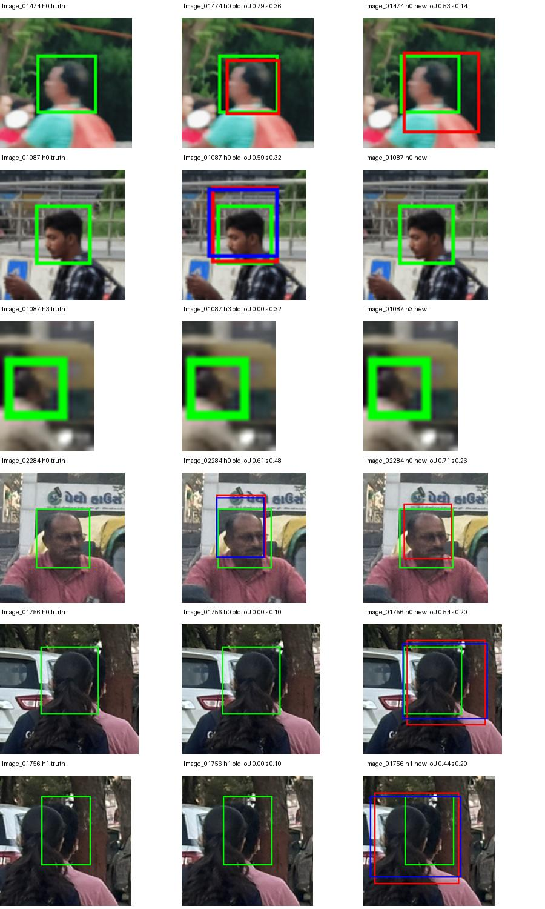

# Entrenamiento con 44 imágenes

Se incorporan las nueve imágenes completas del lote 05. Train: 44 imágenes, 246 cajas, 36 cabezas con casco y 53 sin casco. Val: las mismas cinco imágenes y nueve cabezas (tres con casco, seis sin casco).

Ejecución nueva, sin cargar pesos externos ni checkpoints anteriores. Inicialización aleatoria con el mismo hash inicial que el control. Se conservan semilla 20261124, 150 épocas, batch 2, AdamW lr 0.0003 constante, paso 8, propuestas ×4, aumentos fotométricos y diagnóstico cada diez épocas. Selección por mAP global, sin cambiar el criterio para favorecer sin casco.

Cambian los datos y las actualizaciones totales: 2700 → 3300. No es una comparación a igual número de pasos ni permite atribuir causalmente el cambio solo a nuevos ejemplos. No se ejecutó el control a paso exacto 1950 sugerido como experimento separado.

Mejor época nueva: 75; duración: 561.2 segundos.

| AP@0,50 | 35 imágenes | 44 imágenes |
|---|---:|---:|
| motocicleta | 63.54 % | 62.38 % |
| persona_ocupante | 56.35 % | 49.22 % |
| cabeza_con_casco | 100.00 % | 33.66 % |
| cabeza_sin_casco | 37.87 % | 43.76 % |
| mAP@0,50 | 64.44 % | 47.26 % |

## Sin casco: correspondencia uno a uno

Inferencia congelada en batch 2 con la misma agrupación/padding que la evaluación del entrenador. Se reprodujo el mAP guardado de ambos checkpoints. IoU ≥0,5; seis cabezas reales.

| Confianza | Antes TP / FP / FN | Ahora TP / FP / FN |
|---|---:|---:|
| 0.05 | 3 / 7 / 3 | 3 / 8 / 3 |
| 0.5 | 0 / 1 / 6 | 0 / 0 / 6 |



Verde: referencia; rojo: predicción sin casco de mayor IoU; azul: con casco. Solo se dibujan predicciones con IoU >0,1 respecto de esa cabeza. Las puntuaciones del gráfico corresponden a la caja de mayor IoU, no necesariamente a la de máxima confianza.

AP no es exactitud ni COCO mAP50:95. Cinco imágenes consultadas repetidamente y una sola semilla no confirman generalización. Test no se utilizó. No se ajustaron umbrales, no se modificaron etiquetas y el conteo permanece deshabilitado.

Los JSON conservan pérdidas por componente, propuestas periódicas, predicciones y ranking sin casco. Las 29 pruebas unitarias pasaron. Checkpoints propios en runs/detector-separate-v2-expanded-03/.

## Reproducción

```powershell
.venv/Scripts/python.exe training/train.py --task detector --separate-classes --dataset data/prepared/helmet-separate-v2-expanded-03 --epochs 150 --batch-size 2 --workers 0 --seed 20261124 --constant-lr --head-probe-every 10 --photometric --feature-stride 8 --proposal-multiplier 4 --run detector-separate-v2-expanded-03
```

Usar un nombre nuevo para repetir; el entrenador rechaza sobrescribir una ejecución.

## Interpretación del resultado

AP sin casco mejora de 37,87 % a 43,76 % (+5,89 puntos), pero sigue por debajo del 50,50 % observado con el modelo de 25 imágenes. El mAP global baja de 64,44 % a 47,26 %. La mejora no aumenta el recall sin casco: ambos detectan 3/6 a confianza 0,05. El ranking nuevo empieza con dos aciertos y el tercero llega en posición 5; mejora el orden respecto al falso positivo que encabezaba el ranking anterior. Los falsos positivos totales suben de 7 a 8 a 0,05.

A confianza 0,5, ambos tienen cero aciertos sin casco. El falso positivo anterior por encima de 0,5 desaparece (1→0), pero tampoco hay predicciones correctas aceptadas. Los tres aciertos nuevos puntúan aproximadamente 0,256, 0,195 y 0,136. No se cambió el umbral.

La inspección visual muestra que se recupera Image_01756 h0, vista desde atrás (IoU 0,543 aproximadamente), y se pierde Image_01087 h0. Image_01087 h3 y la cabeza ocluida Image_01756 h1 siguen omitidas. Hay predicciones casco/sin casco superpuestas en la escena trasera. No se modificaron sus etiquetas.

Decisión: conservar ambos modelos; no promover el nuevo como mejora global ni habilitar conteo. El siguiente experimento recomendado es controlar el número de actualizaciones y repetir con otra semilla antes de atribuir la variación al lote. Esa comparación exige ejecuciones nuevas desde cero y el guardado de pasos exactos; no se realizó en esta ejecución. Continuar ampliando diversidad revisada puede ayudar, pero esta muestra no demuestra que sea suficiente.

El diagnóstico auxiliar en `head-diagnostics/diagnosis.json` procesa imágenes individualmente y cubre 4/9 cabezas en propuestas RPN y predicciones finales de clase correcta. No confundir esa cobertura por referencia con el matching uno a uno del AP calculado en batch 2. Se conservan los diagnósticos periódicos y pérdidas de la última época para examinar la variabilidad.
